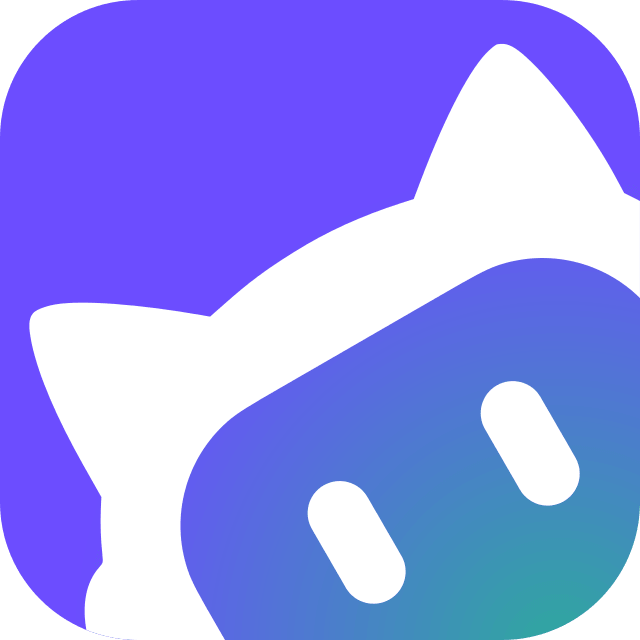
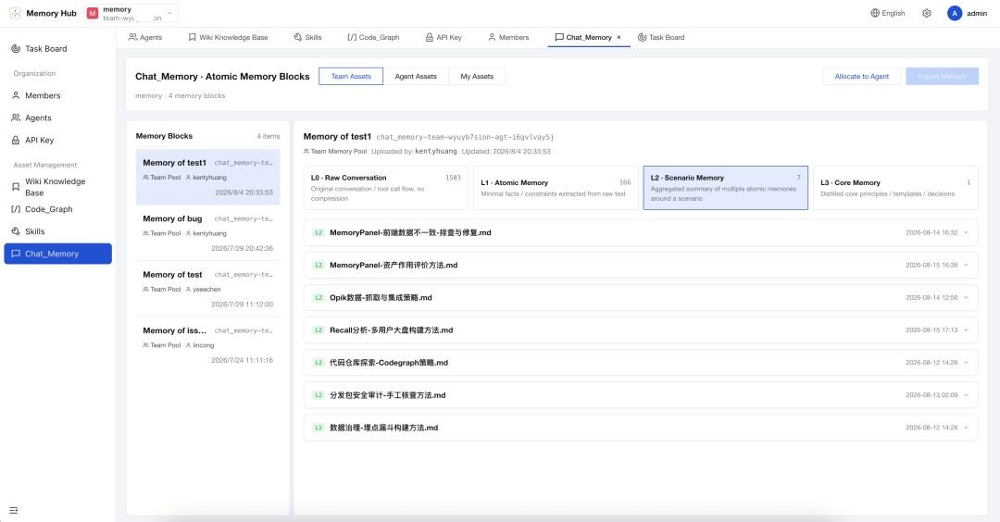
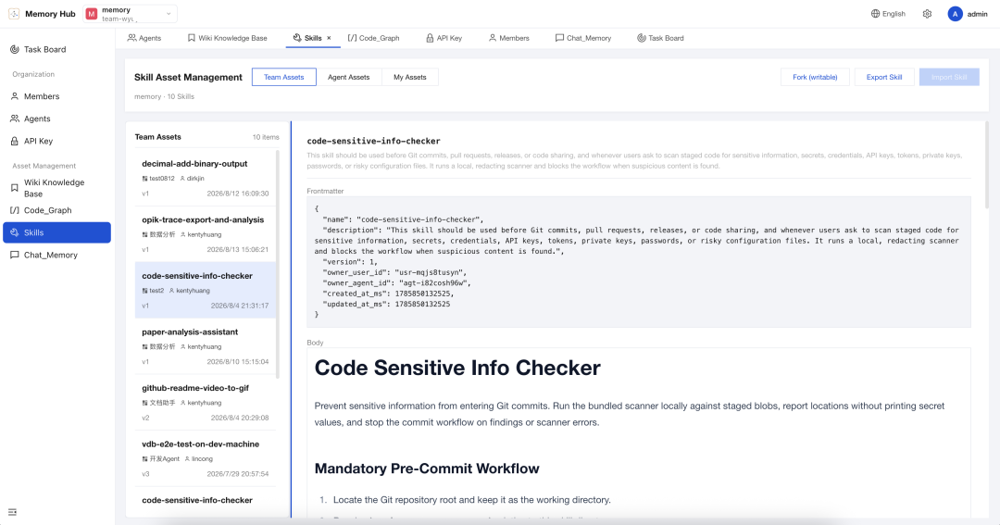
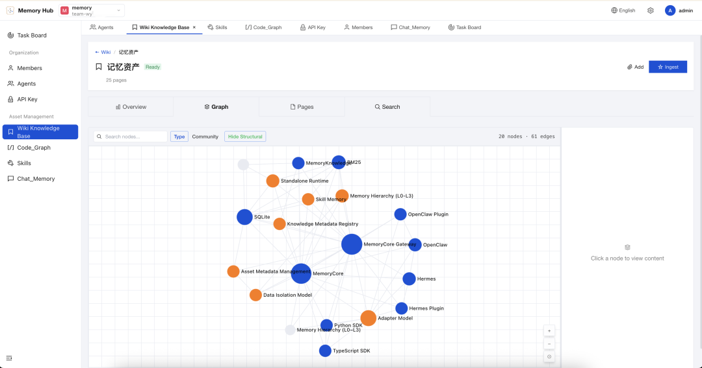
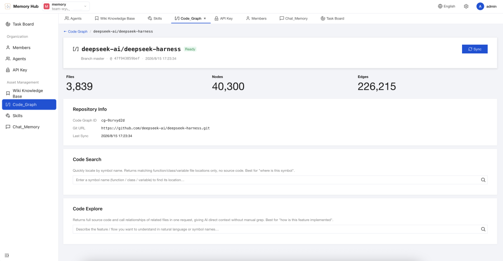
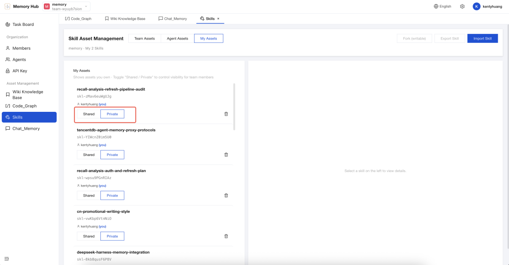

<div align="center">


### Agents remember. Humans innovate.

<a href="https://trendshift.io/repositories/29310?utm_source=repository-badge&amp;utm_medium=badge&amp;utm_campaign=badge-repository-29310" target="_blank" rel="noopener noreferrer"></a>

[](https://github.com/TencentCloud/TencentDB-Agent-Memory/releases/latest)
[](./LICENSE)
[](https://nodejs.org/)
[](https://github.com/openclaw/openclaw)
[](https://hermes-agent.nousresearch.com/docs/)
[](https://discord.gg/dJQM6mKMF)

[Installation](#installation) · [Supported Agents](#all-agents-share-the-same-memory-server) · [Best Practices](#best-practices) · [What Is It?](#what-is-tencentdb-agent-memory) · [Team Play](#example-build-a-growing-agent-team-for-a-one-person-company) · [Technical Implementation](#technical-implementation) · [Benchmark](#benchmark) · [Roadmap](#roadmap)

[**English**](./README.md) · [简体中文](./README_CN.md)

</div>

---

<td>
   <video src="https://github.com/user-attachments/assets/efb1a808-1f86-4cfe-802c-f7453f7ca938" width="100%" controls autoplay loop muted playsinline></video>
</td>


# Installation

Start the full stack with one command: `memory-core`, `memory-hub`, and `proxy`.

```bash
git clone https://github.com/Tencent/TencentDB-Agent-Memory.git
cd TencentDB-Agent-Memory/deploy/global-images
cp .env.example .env
$EDITOR .env       # Configure both sets of LLM settings: memory and proxy
./start-all.sh     # Start the stack and print a command you can copy to launch Claude Code
```

Open the panel at [http://localhost:8125](http://localhost:8125).

For standalone Memory Hub deployment, Proxy setup for Claude Code and CodeBuddy, shutdown and cleanup, and port configuration,
see [**INSTALL.md**](./INSTALL.md) ([Chinese](./INSTALL_CN.md)).

### Migrating Data from Older Versions

If you're upgrading from v0.x or v1.x to v2.0.0 or later, you can migrate your existing data.
See the [**Data Migration Tool (v2 → v3)**](./MemoryCore/scripts/migrate-v2-to-v3/README.md) for instructions and options. Skip this step for a fresh install.

## All Agents Share the Same Memory Server

Follow your client's setup guide to configure the Proxy URL and User Key. Supported clients connect using their existing model protocols, without an additional plugin, hook, or MCP server.

<table>
<tr>
<td align="center" width="140"><a href="./agents/dsh/"><br /><sub><b>DeepSeek Harness</b></sub></a></td>
<td align="center" width="140"><a href="./agents/claude-code/"><br /><sub><b>Claude Code</b></sub></a></td>
<td align="center" width="140"><a href="./agents/codex/"><br /><sub><b>Codex</b></sub></a></td>
<td align="center" width="140"><a href="./agents/codebuddy/"><br /><sub><b>CodeBuddy</b></sub></a></td>
</tr>
<tr>
<td align="center" width="140"><a href="./agents/workbuddy/"><br /><sub><b>WorkBuddy</b></sub></a></td>
<td align="center" width="140"><a href="./agents/hermes/"><br /><sub><b>Hermes</b></sub></a></td>
<td align="center" width="140"><a href="./agents/openclaw/"><br /><sub><b>OpenClaw</b></sub></a></td>
<td align="center" width="140"><a href="./agents/adapter-agent-development.md"><sub><b>More integrations coming soon...</b></sub></a></td>
</tr>
<tr>
<td align="center" width="140" colspan="2"><a href="./agents/opencode/"><picture><source media="(prefers-color-scheme: dark)" srcset="https://opencode.ai/brand/files/opencode-logo-dark-square.png" /></picture><br /><sub><b>OpenCode</b></sub></a></td>
<td align="center" width="140" colspan="2"><a href="https://github.com/TencentCloud/TencentDB-Agent-Memory/releases/tag/v2.0.2"><br /><sub><b>Pi</b></sub></a></td>
</tr>
</table>

See the table above or the [integration overview](./agents/README.md) for client-specific setup instructions.

OpenCode has a [ready-to-use adapter configuration](./adapters/opencode/README.md), and Pi connects through OpenAI Chat Completions. After binding a session, you can save a Team, Agent, and Task combination as the default for new sessions.

Don't see your preferred Agent? The [new client integration guide](./agents/adapter-agent-development.md) explains how to add support. PRs are welcome; see [**CONTRIBUTING.md**](./CONTRIBUTING.md) to get started.

### Best Practices

Once you've deployed the stack and connected your Agents, use the guide to set up a team, import and assign memory assets, and see how well they work on a real task.

See the [Best Practices guide](https://tencentcloud.github.io/TencentDB-Agent-Memory/best-practices).

# What Is TencentDB Agent Memory?

We started with a practical question: **How can we stop doing the same work every time we use an Agent?**

You shouldn't have to explain the project again every time you start a session. Agents shouldn't have to reread the same documents from page one. Once a workflow works, the next Agent should be able to pick it up.

Memory goes beyond the conversation itself. **If information can save the next Agent time or help it avoid a mistake, it should be saved, organized, and reused.**

```text
Existing information → Reusable memory assets → Fewer turns and less rework → More consistent results in less time
```

### Capture Experience and Pass It to the Next Agent

**Memory Hub** gives Agent teams a place to capture what they learn on the job, share it across the team, and put it to work from a new member's first session.

1. **Automatic asset extraction**: Turn conversations and tasks into Chat Memory and Skills, and documents and code into Wiki and CodeGraph assets. Manage, review, and route them from one place.
2. **Portable across Agent frameworks**: Memory assets are independent of the framework. Move them between frameworks, or let multiple Agents and team members share and maintain them.
3. **Easier cold starts**: Import existing documents, repositories, and Agent sessions so a new team can build on work that's already been done.

### 🧠 Chat Memory: Remember People and Context

- **Chat Memory** keeps track of preferences, facts, decisions, and past interactions.
- Session bindings and permissions determine which memories an Agent can access. When an Agent returns to the same work, it can reuse the context.
- Raw conversations are distilled through four layers: L0 Conversation → L1 Atom → L2 Scenario → L3 Persona.



> “Leave the old authentication module alone. The mobile app still uses it.” An Agent should remember a constraint like this without someone having to repeat it.

### ⚡ A Skill Library That Captures What Works

- After a complex task, Agents can turn conversations and tool calls into reusable Skills. Assign a Skill to a specific Agent so it can load it when needed. Skills can be edited and exported from the panel.
- A Skill includes a version, resource files, trigger conditions, steps to follow, and validation rules.
- Personal Skills are private by default. After review, they can be shared with the team and assigned to other Agents.



> Troubleshooting, code reviews, release checks: work out the steps once and the whole team can reuse them.

### 📖 A Knowledge Map for Docs and Code

- **Wiki** turns product docs, design proposals, and runbooks into structured pages and a link graph. It imports Markdown, plain text, HTML, Word, Excel, PowerPoint, and PDF files.



- **CodeGraph** indexes code symbols, files, call relationships, and impact paths.



- Agents can search and read the indexed material, look up callers and callees, and run impact analysis before changing code.

> Wiki helps an Agent get to the right document without browsing every folder. CodeGraph shows where the code lives and what a change could affect.

### 🛡️ A Team Memory Panel That People Control

- Create Teams and Agents in Memory Hub, then review, share, and assign memory assets.
- Manage asset ownership, versions, status, visibility, usage counts, and Agent bindings in one place.
- Use `private` for the Owner only, `team` for the whole team, and `restricted` to grant access through User, Role, or Agent ACLs.
- Roles operate at two levels. A **global System Admin** creates teams, adds members, manages users, and can use asset management features for Wiki, CodeGraph, and Skills. Within a team, **Admin** and **Member** roles govern how people collaborate on assets and control access. Each asset has an Owner who automatically has permission to manage it.



## Cold Start: Load the Save File, Then Get to Work

Most Agents start by learning your project all over again. TencentDB Agent Memory saves what your team has already learned so the next Agent can start there:


Admins can configure a default Agent template for the team so new members can pick up the team's way of working.

Import these assets from the panel and let Memory Hub process them:

- **Codebases**: Import a public repository or a private repository with credentials configured. **CodeGraph** indexes symbols, files, call relationships, and impact paths.
- **Documents and files**: Upload files or import them from a configured external source. **Wiki** organizes them into structured pages and a link graph.
- **Conversation sessions**: Import past sessions from [supported clients](./agents/README.md#本地资产导入). **Skills and Chat Memory** are extracted from those conversations for reuse.

> Give each new Agent the team's save file so it can pick up where the last one left off.

## Example: Build a Growing Agent Team for a One-Person Company

Open Memory Hub and create a Team:

```text
Tiny but Serious Inc.
├── 👤 You · Set goals / Make decisions
├── 🔭 Scout · Research / Spot opportunities
├── 🛠 Builder · Write code / Build the product
├── 🧪 Reviewer · Test / Find problems
└── 🧠 Agent Memory · Keep what the team learns
```

Instead of working across four disconnected chat windows, you have a team with distinct roles and a shared body of experience to draw from.

### Recruit Your Agents, Then Equip Them

```text
🔭 Scout
   ├── User Interview Chat Memory
   ├── Market Research Wiki
   └── Competitor Analysis Skill

🛠 Builder
   ├── Product Wiki
   ├── Project CodeGraph
   └── Feature Delivery Skill

🧪 Reviewer
   ├── Past Incident Chat Memory
   ├── Project CodeGraph
   └── Release Checklist Skill
```

Each role gets its own Loadout. Give Agents the memory they need to do their jobs without crowding out the task at hand.

**Even a one-person company can build up experience that pays off with every task.**

## Memory Assets Go Beyond Chat History

RAG helps an Agent find relevant information. Team Memory also tracks who can use it, which version is current, and which Agent should receive it.

| | Chat History | Basic RAG | TencentDB Agent Memory |
| :--- | :---: | :---: | :---: |
| Understanding the user across sessions | △ | △ | ✅ Chat Memory |
| Capturing reusable workflows | — | — | ✅ Skill |
| Document structure and relationships | — | △ Chunk retrieval | ✅ Wiki + Link Graph |
| Code calls and change impact | — | △ Text matches | ✅ CodeGraph |
| Owner / Version / Status | — | — | ✅ |
| Team sharing and Agent Loadout | — | — | ✅ |
| Private / Team / ACL | — | △ | ✅ |

## What You Can Do in Memory Hub

| Capability | What you can do in Memory Hub |
| :--- | :--- |
| **Team Setup** | Create a Team, add people and Agents, and decide what they can share |
| **Asset Library** | Browse, search, review, and manage Chat Memory, Skills, Wiki, and CodeGraph |
| **Agent Loadout** | Bind memory assets to individual Agents, adjust priority and usage, and configure the team's default template |
| **Knowledge Workshop** | Build Wiki and CodeGraph assets and check their status and metadata |
| **Access Control** | Choose private, team, or ACL-based access and revoke sharing when needed |
| **Asset Usage Analytics** | Enable optional analytics to see how often memory, skill, and knowledge tools are called |

Open an asset to see what it contains, where it came from, which version you're looking at, who it was assigned to, and whether it was used recently.

## Carry Experience from One Loop to the Next


The Agent runs the loop; Memory carries its results forward. Useful interactions go into Chat Memory, proven workflows become Skills, and changes to docs and code are reflected through Wiki ingest and CodeGraph sync.

**A faster loop can still repeat the same mistakes. Memory gives each iteration a chance to build on the last one.**

## Share Team Experience and Keep Private Assets Private

New Chat Memory and Skills are private by default. You decide when to share them.

| Visibility | Meaning |
| :--- | :--- |
| `private` | Only the Owner can read the asset; Team Admins have no special access |
| `team` | Team members can read it; the Owner or Admin can manage it |
| `restricted` | Grant access through User, Role, or Agent ACLs |
| `agent` | Assign the asset to specific Agents within the same team |

For example, give the Release Skill to the Release Agent, share the Architecture Wiki with all development Agents, and assign CodeGraph to both the Coder and Reviewer.

## Technical Implementation

TencentDB Agent Memory focuses on three questions: **What is worth keeping, who can use it, and how can the next Agent retrieve just what it needs?**


### 1. Memory Builds Up in Layers

Conversations are saved at L0. An asynchronous pipeline then distills them into layers with different levels of detail:

| Layer | What it stores | Main use |
| :--- | :--- | :--- |
| **L0 Conversation** | Raw conversations with full context | Verify the original wording, time, and source |
| **L1 Atom** | Facts, preferences, constraints, and events extracted from conversations | Retrieve precise information an Agent can act on |
| **L2 Scenario** | Blocks of knowledge organized by project or scenario | Restore the context for a piece of work |
| **L3 Core / Persona** | Long-term profiles, recurring patterns, and higher-level insights | Help the Agent quickly understand the user and team |

Retrieval follows the same layers. L2 and L3 give the Agent context quickly; when it needs a specific fact, BM25, vector search, and reciprocal rank fusion (RRF) retrieve details from L1 and L0. Result limits, character budgets, and timeouts keep memory from taking over the context window.

### 2. Memory Is Part of Each Agent's Loadout

Chat Memory, Skills, Wiki, and CodeGraph are all registered as Memory Assets. Memory Hub uses **Fixed Binding + ACL** to determine what an Agent can use. It first limits access by Team, User, Agent, and visibility, then retrieves relevant assets for the current query.

This lets teams share what they've learned while keeping private assets protected. When you switch Agents or frameworks, you can reassign existing assets without retraining.

### 3. Agents Retrieve Knowledge on Demand

Documents become searchable Wiki pages whose links the Agent can follow. CodeGraph indexes repository files, symbols, and call relationships. Agents call the knowledge tools they have access to when they need a page, a source file, or an impact path. The Knowledge service exposes `/v3/tools/list` and `/v3/tools/call` for integrations.

Documents and code stay available as memory without taking up space in the Agent's context until needed.

## Benchmark

| Benchmark | Without TencentDB Agent Memory | With TencentDB Agent Memory | Relative Improvement |
| :--- | :---: | :---: | :---: |
| **PersonaMem** | 48% | **76%** | **+59%** |

PersonaMem measures how well an Agent understands and applies information about a user after extended interactions.

## Notes

- Wiki and CodeGraph build asynchronously. Wait until they report `ready` before using them.
- CodeGraph supports public HTTPS repositories and private repositories with team credentials. To clone a private repository over SSH, get the public key from the panel and grant it access on your code hosting platform.
- Memory Hub lets you assign assets manually. On-demand Skill selection in the Proxy is off by default. When enabled, the Proxy chooses which Skills to load for the current conversation.

## Related Documentation

- [Full Installation Guide](./INSTALL.md)
- [Client Integration and Local Asset Import](./agents/README.md)
- [Data Migration Tool (v2 → v3)](./MemoryCore/scripts/migrate-v2-to-v3/README.md)
- [Knowledge OpenAPI](./MemoryKnowledge/openapi.yaml)
- **API Documentation**:
  - [Memory Core v3 API](./MemoryCore/v3-api-memorycore-doc.md)
  - [Memory Knowledge v3 API](./MemoryKnowledge/v3-api-memoryknowledge-doc.md)
  - [Memory Proxy v3 API](./MemoryProxy/v3-api-memoryproxy-doc.md)
  - [Memory Panel API](./MemoryPanel/panel-api-doc.md)
- [Contribution Guide](./CONTRIBUTING.md)


---
## Roadmap

[v2.0.3](https://github.com/TencentCloud/TencentDB-Agent-Memory/releases/tag/v2.0.3) adds default session bindings and support for rich document formats in Wiki. See [GitHub Releases](https://github.com/TencentCloud/TencentDB-Agent-Memory/releases/latest) for the latest stable release and [CHANGELOG.md](./CHANGELOG.md) for the release history.

See [**ROADMAP.md**](./ROADMAP.md) ([Chinese](./ROADMAP_CN.md)) for earlier plans.

---
## Acknowledgements

TencentDB Agent Memory builds on the work of the open-source community:

- [**CodeGraph**](https://github.com/colbymchenry/codegraph): We **reuse code from this project** in our CodeGraph asset module. Its pre-indexed code graph is the basis for our implementation.
- [**Hermes Agent**](https://github.com/nousresearch/hermes-agent) (Nous Research): We **reuse and extend parts of the Hermes Agent Skill implementation** to manage Skill assets.
- [**Andrej Karpathy's “LLM Wiki”**](https://gist.github.com/karpathy/442a6bf555914893e9891c11519de94f): The idea of an LLM maintaining a knowledge base incrementally, so it becomes more useful over time, shaped how we build and maintain the Wiki layer.

Thank you to the authors and contributors of these projects.

---
## Community & Contributing

We welcome bug reports, feature ideas, documentation fixes, benchmark reproductions, integrations, and pull requests. There is still a lot to figure out about Agent memory, and we'd like to build it with you.

- 🐞 **Found a bug or have a question?** Open a [GitHub Issue](https://github.com/TencentCloud/TencentDB-Agent-Memory/issues). We'll respond within 24 hours.
- 💡 **Have an idea to share?** Start a thread in [GitHub Discussions](https://github.com/TencentCloud/TencentDB-Agent-Memory/discussions).
- 🛠️ **Want to contribute code?** Start with the [contribution guide](./CONTRIBUTING.md).
- ☁️ **Try the hosted version**: [Tencent Cloud Agent Memory](https://cloud.tencent.com/product/agm) is now available.
- 💬 **Want to join the community?** Scan the QR code to join the **Agent Memory WeChat group** and talk directly with the early developers.
<p align="center"></p>

---

<p align="center">
Let the path the team has walked become the next Agent's starting line.
</p>

---

## ✨ Contributors

> 💡 Thank you to everyone who has helped make TencentDB Agent Memory better.

<div align="center">
  <a href="https://github.com/TencentCloud/TencentDB-Agent-Memory/graphs/contributors">
    
  </a>

  <br /><br />
<a href="https://github.com/TencentCloud/TencentDB-Agent-Memory/issues">
  
</a>

</div>


<table width="100%">
  <tr>
    <td width="68%">
      <b>If TencentDB Agent Memory helps you, give the project a ⭐ on GitHub.</b><br />
      Have a suggestion? Open an issue and tell us what you have in mind.
    </td>
    <td width="32%" align="right">
      
    </td>
  </tr>
</table>

---

## Star History

<p align="center">
  <a href="https://star-history.dera.page/#TencentCloud/TencentDB-Agent-Memory&Date">
    
  </a>
</p>

---

[MIT](./LICENSE) © TencentDB Agent Memory Team
